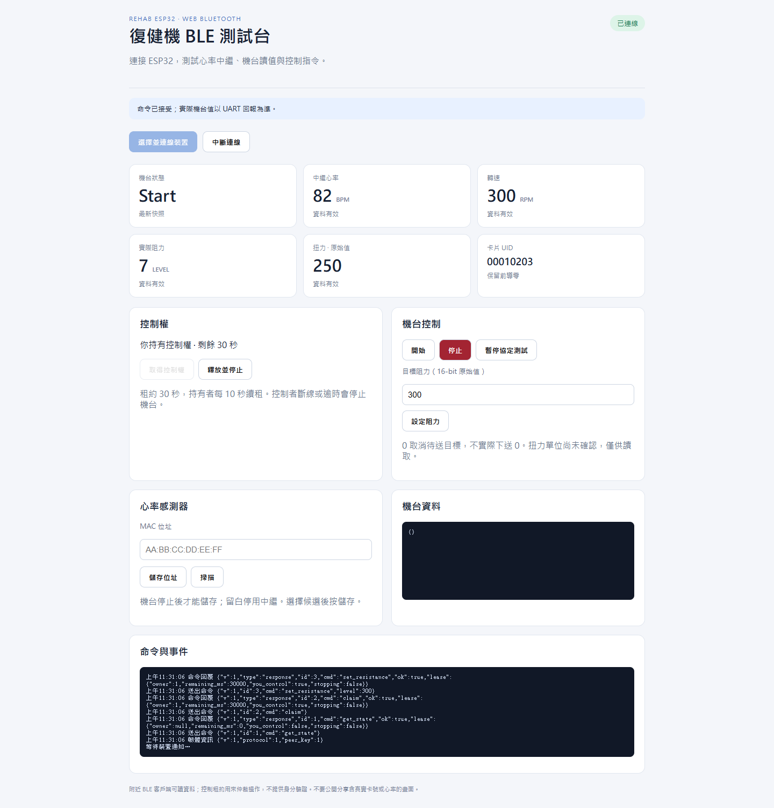

# Rehab ESP32 WebBLE

ESP32-S3 復健機 BLE Gateway：中繼 BLE 心率、接收機台 UART、讀取 CL-2000 USB 卡片，並透過 Web Bluetooth 提供即時資料與阻力控制。

這是 [rehab_esp32](https://github.com/root50643/rehab_esp32) 的獨立衍生專案，使用乾淨 Git 歷史。原 repo 不變。此版本沒有 Wi-Fi、TCP、HTTP Portal 或雲端資料上傳；網頁從 GitHub Pages 載入後，由瀏覽器直接與附近 ESP32 通訊。

## 快速使用

1. 依 [接線文件](docs/WIRING.md) 確認 ESP32-S3、機台、CL-2000 的電氣介面。
2. 依 [建置與燒錄](docs/BUILD_AND_FLASH.md) 建置並燒錄；先備份原 Flash。
3. 開啟 [Web BLE 測試頁](https://root50643.github.io/rehab_esp32_webble/)，使用 Windows/macOS Chrome 或 Edge、Android Chrome。Safari/Firefox 不提供本頁需要的 Web Bluetooth API。
4. 按「選擇並連線裝置」，選擇 `RehabWebBLE`。初始為唯讀模式。
5. 按「取得控制權」，停止機台後掃描或填入心率感測器 MAC 並儲存。
6. 觀察心率、RPM、阻力、扭力與 UID，測試 Start、Stop 與阻力命令。

Web Bluetooth 需要 HTTPS 或 localhost、使用者點擊與裝置授權，見 [Chrome 官方文件](https://developer.chrome.com/docs/capabilities/bluetooth)。

## 能力與邊界

- 同一個 NimBLE host 同時作 Central（1 個心率感測器）及 Peripheral（最多 4 個網頁客戶端）。固定 NimBLE-Arduino 2.5.1，建置連線池設為 5。
- STATE 最高 10 Hz；低 MTU 降為 1 Hz，各客戶端有獨立有界佇列。
- 第一個 claim 者取得 30 秒控制租約，頁面每 10 秒 heartbeat。斷線、逾時或 release 取消排隊控制並停止機台。
- 心率為 180D/2A37，連續三筆有效非零通知後就緒，10 秒失效。機台 0x28/0x3F 各自 5 秒失效，數值回傳 null。
- 阻力沿用 UART 0x44。目標、已送值、ACK、機台回報分開；0 為取消待送且不實際下送。
- 扭力、功率、距離與熱量保留原始值，不推測單位；沒有寫入扭力或任意 UART 命令。
- Pause 僅沿用舊協定的確認行為，不宣稱有硬體暫停效果；需要停止時使用 Stop。
- NVS 只存心率 MAC 與設定版本；UID、心率與事件只在 RAM。控制租約不是身分驗證，附近 BLE 客戶端可讀資料。

## 開發

```powershell
# PowerShell 7、Arduino CLI 1.5.1、Python 3、Node 20+、C++17 compiler
python tools/run_tests.py --sanitize
npm install
npx playwright install chromium
npm run test:browser
./tools/build.ps1 -InstallCore
```

Windows 建置使用 ASCII 暫存路徑。請使用建置腳本，避免漏掉 5 連線設定。Web 原始碼在 `web/`，不再嵌入韌體。本機可用 `python -m http.server 8080 --directory web`，開啟 `http://localhost:8080`。

## 文件



上圖為真實頁面搭配人工 BLE mock，並非實機讀值。

- [架構](docs/ARCHITECTURE.md)
- [GATT UUID、JSON、分片、租約與遊戲整合](docs/PROTOCOL.md)
- [建置與燒錄](docs/BUILD_AND_FLASH.md)、[硬體接線](docs/WIRING.md)
- [驗證證據與實機待驗項目](docs/VALIDATION.md)
- [設定](docs/CONFIGURATION.md)、[診斷](docs/DEBUGGING.md)、[故障排除](docs/TROUBLESHOOTING.md)

依擁有者選擇不放 LICENSE；公開可見不代表授予再利用授權。SDK 與依賴依各自授權提供。不要提交 Flash 備份、真實卡號、心率、帳密或現場設定。
