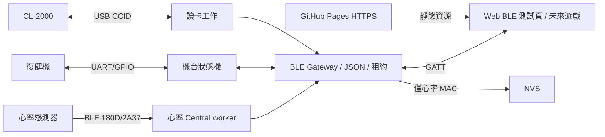

# 架構

Gateway 先初始化 NimBLE host 與 GATT server；心率 worker 隨後使用同一個 source NimBLE host 執行有期限的掃描、連線與 GATT 訂閱。

Callbacks 維護連線／訂閱、重組有上限的 COMMAND 並排入佇列。Arduino loop 的 gateway tick 驗證 JSON、租約與請求 ID，再呼叫有 mutex 的 controller。UART/GPIO 由獨立 FreeRTOS worker 執行，沒有阻塞式 GPIO delay。

每個瀏覽器有獨立 generation key、組包器、回覆／事件 FIFO 與最新狀態槽。斷線清除全部，舊 generation 命令不執行。STATE 合併為最新值；回覆優先於事件與新狀態。佇列滿、通知持續失敗或期限超時會斷開慢端，控制者失聯觸發 fail-safe Stop。

租約由單一 mutex 保護，第一個 claim 勝出。30 秒未 heartbeat、disconnect 或 release 釋放控制權；停止流程未完成時拒絕下一個 claim。Stop 可取消尚未執行的 Start 與阻力，重複 failSafeStop 不延長停止脈衝。

心率／機台／讀卡機各有快照鎖，跨服務不宣稱原子交易。機台保留各封包自己的觀察時間。讀值只在 RAM；NVS 用獨立 rehab_webble namespace，不解讀舊 Wi-Fi 設定。
